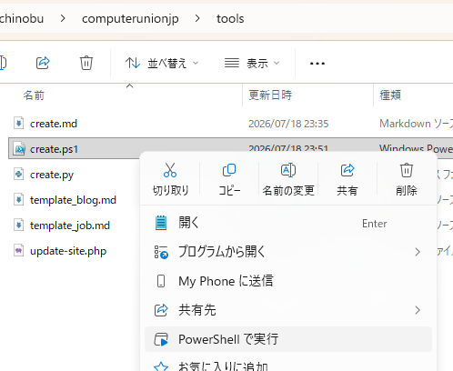

# 原稿取り込みツールの使い方

> 以下の説明ではディレクトリ（フォルダ）名の区切りに `/` （スラッシュ）を使っています。
> Windows で作業する場合は `\` （バックスラッシュ）または `¥` （半角の￥）に読み替えてください。

`drafts` の下に置かれた原稿（`*.md`）を、Front Matter の `categories`
（「しごと情報」または「ブログ」）に応じて適切な ID を採番し、`content`
の下に取り込みます。取り込みに成功したファイルは `drafts` から削除（画像
などの添付ファイルは移動）されます。

Python版 `tools/import.py` と PowerShell版 `tools/import.ps1` があり、
どちらも同じ動作をします。

## 1. 必要な環境

以下のいずれかの環境で動作します。

- Python >= 3.9
- Windows PowerShell 5.1
- PowerShell 7+

## 2. 実行方法

### 2.1 Python版

プロジェクトのルートディレクトリで実行してください。

```sh
$ python tools/import.py
```

Mac OS のシステムの Python を使う場合は `python` を `python3` に
置き換えてください。

### 2.2 Windows PowerShell 5.1 / PowerShell 7

```powershell
PS> .\tools\import.ps1
```

または

```cmd
C:\...\computerunionjp> powershell.exe -File .\tools\import.ps1
```

```cmd
C:\...\computerunionjp> pwsh .\tools\import.ps1
```

または、エクスプローラ上でマウス右クリックして「PowerShell で実行」を選択。



## 取り込みのルール

`drafts` の中身に応じて、次のいずれかの動作になります。

### 1. `drafts` に `*.md` が 1 つだけで、カテゴリが「ブログ」の場合

画像無し／画像有りを選択するプロンプトが表示されます。

```sh
$ ./.venv/bin/python tools/import.py
ブログの記事を取り込みます。
  2. ブログ（画像無し）
  3. ブログ（画像有り）
番号を入力してください (2～3): 2
drafts/draft.md を content/blog/8083.md としてインポートしました。
```

### 2. `drafts` に `*.md` が 1 つだけで、ほかに画像などのファイルがあり、カテゴリが「ブログ」の場合

プロンプトは表示されず、自動的に「画像有り」として取り込まれます。
`*.md` 以外のファイルは、取り込み先のディレクトリ（`index.md` と同じ
ディレクトリ）に移動されます。

```sh
$ ./.venv/bin/python tools/import.py
drafts/draft.md を content/blog/8083/index.md としてインポートしました。
drafts/photo.jpg を content/blog/8083/photo.jpg に移動しました。
```

### 3. `drafts` に `*.md` のみが複数（または 1 つで「ブログ」以外のカテゴリ）存在する場合

プロンプトは表示されず、各ファイルのカテゴリ（「しごと情報」または
「ブログ」）に応じて自動的に取り込み先が決まります。複数ファイルの場合
は、ID を 1 つずつ採番しながら順番に取り込みます。

```sh
$ ./.venv/bin/python tools/import.py
drafts/draft1.md を content/job/8083.md としてインポートしました。
drafts/draft2.md を content/job/8084.md としてインポートしました。
```

### 4. `drafts` に `*.md` が複数あり、画像などの添付ファイルも存在する場合

添付ファイルのファイル名（拡張子を除いた部分）が `<md のファイル名
（拡張子を除いた部分）>-` または `<md のファイル名（拡張子を除いた部分）>_`
で始まっている場合、その `*.md` の添付ファイルとみなされます
（`-` 区切り、`_` 区切りのどちらにも対応しています）。該当する `*.md`
が「ブログ」カテゴリであれば、画像有りとして取り込まれ、添付ファイルは
取り込み先のディレクトリ（`index.md` と同じディレクトリ）に移動されます。

```
drafts/
  article1.md         <- categories: ブログ
  article1-1.jpg
  article1-2.jpg
  article2.md         <- categories: ブログ
  article2-1.png
```

```sh
$ ./.venv/bin/python tools/import.py
drafts/article1.md を content/blog/8083/index.md としてインポートしました。
drafts/article1-1.jpg を content/blog/8083/article1-1.jpg に移動しました。
drafts/article1-2.jpg を content/blog/8083/article1-2.jpg に移動しました。
drafts/article2.md を content/blog/8084/index.md としてインポートしました。
drafts/article2-1.png を content/blog/8084/article2-1.png に移動しました。
```

どの `*.md` にもマッチしない添付ファイル（例: 変換レポートなど、原稿や
画像以外の付随ファイル）が 1 つでもある場合は、それらのファイル名を表示
したうえで、スキップしてインポートを続行するかどうかを確認するプロンプト
が表示されます。`Y`（または何も入力せずに Enter）を入力するとスキップ
して取り込みを続行し、すべてのインポートが正常に終わった時点でスキップ
したファイルは `drafts` から削除されます。`n` を入力すると、ファイルを
一切変更せずに処理を中止します。

```sh
$ ./.venv/bin/python tools/import.py
drafts/ に *.md 以外のファイルが含まれています。
対象外のファイル: conversion-report.txt
これらのファイルをスキップしてインポートを続行しますか？ [Y/n]: y
drafts/article1.md を content/blog/8083/index.md としてインポートしました。
drafts/article1-1.jpg を content/blog/8083/article1-1.jpg に移動しました。
drafts/article1-2.jpg を content/blog/8083/article1-2.jpg に移動しました。
drafts/article2.md を content/blog/8084/index.md としてインポートしました。
drafts/article2-1.png を content/blog/8084/article2-1.png に移動しました。
drafts/conversion-report.txt を削除しました。
```

添付ファイルを持つ `*.md` のカテゴリが「ブログ」以外の場合は、プロンプト
を表示せずに中止します。

### 5. それ以外の場合は中止

- `drafts` が空、または存在しない場合
- `drafts` に `*.md` が 1 つもないのに、`*.md` 以外のファイルが含まれて
  いる場合
- 対象外のファイル（どの `*.md` にもファイル名がマッチしないもの）が
  あり、スキップの確認プロンプトで `n` を入力した場合
- 添付ファイルを持つ `*.md` のカテゴリが「ブログ」以外の場合

は、メッセージを表示して処理を中止します。ファイルは変更されません。

```sh
$ ./.venv/bin/python tools/import.py
drafts/ に *.md 以外のファイルが含まれています。
対象外のファイル: conversion-report.txt
これらのファイルをスキップしてインポートを続行しますか？ [Y/n]: n
処理を中止します。
```

## 注意事項

- 取り込み先の ID は、`content/blog` と `content/job` に存在する最大の
  数値 ID の次の番号が自動的に採番されます（[`tools/create.py`](create.py)
  /[`tools/create.ps1`](create.ps1) と同じ採番ルールです）。
- カテゴリを判定できない原稿（Front Matter に `categories` が無い、ある
  いは「しごと情報」「ブログ」のいずれでもない場合）はスキップされ、
  `drafts` に残ります。
- `drafts/.gitignore` により、`drafts` の中身（`.gitignore` 自体を除く）
  は Git の管理対象外です。
